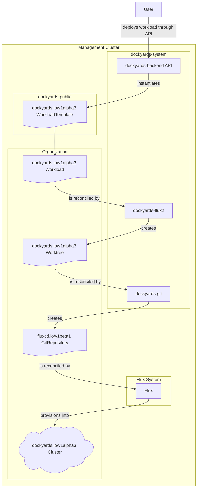

# Dockyards Git

`dockyards-git` is the lightweight Git host that turns `dockyards.io/v1alpha3` `DockyardsWorktree` resources into real repositories and makes them available to the Flux stack and other consumers that clone customer workspaces.

## Component diagram


The diagram walks the full lifecycle that starts when a user requests a workspace: `dockyards-backend` instantiates the workload and template objects, `dockyards-flux2` reconciles those resources and creates a `DockyardsWorktree`, and `dockyards-git` finally owns that `Worktree` object. `dockyards-git` turns the `Worktree` into a real repository, exposes it through `git-http-backend`, and feeds the resulting location back into the `FluxGitRepository` that is watched by the Flux source/kustomize/helm stack shown in the `Flux System` subgraph.

## Responsibilities

- **Worktree reconciliation:** `DockyardsWorktreeReconciler` (controllers/dockyardsworktree_controller.go) watches the CRD, creates or updates the on-disk repository under `--git-project-root/worktrees/<uid>`, writes every `spec.files` entry, commits the changes, and records the new URL/reference in `status`.
- **Git hosting:** A CGI `git-http-backend` binary (`--git-cgi-path`) serves the repository on port 9002 so Flux `GitRepository` sources and other Git clients can fetch the workspace. The CGI handler inherits the same filesystem root `--git-project-root` that the controller uses.
- **Status propagation and Flux linkage:** Once the repository exists, the controller sets `status.url`, `status.referenceName`, and `status.commitHash`. The `FluxGitRepository` resource shown in the diagram is driven by those status fields, is reconciled by `dockyards-flux2`, and in turn pushes the workspace manifests through the Flux source/kustomize/helm stack.
- **Cleanup helpers:** `GitRepository.DeleteRepository` removes repository data when owner references are deleted so the on-disk project tree does not leak.

## Runtime configuration

| Flag | Default | Purpose |
| --- | --- | --- |
| `--git-project-root` | `/tmp/dockyards-git` | Root directory for all repositories (`/worktrees` and `/deployments`). |
| `--git-cgi-path` | `/usr/libexec/git-core/git-http-backend` | CGI binary that powers `git-http-backend`. |
| `--repository-hostname` | `dockyards-git.$(METADATA_NAMESPACE).svc.cluster.local:9002` | Hostname advertised in `Worktree.status.url`. |
| `--metrics-bind-address` | `0` | Controller-runtime metrics server bind (set to `0` to disable). |

The `config/base` manifests deploy the controller into `dockyards-system` with a service at `port 9002` and the CGI handler wired to the same project root via environment variables.

## Development

```bash
# build the controller and run unit tests
go test ./...
``` 

Logs and metrics are emitted through controller-runtime's `slog` wiring configured in `main.go`. Use `scripts` or your cluster's logging stack to inspect them when debugging.
